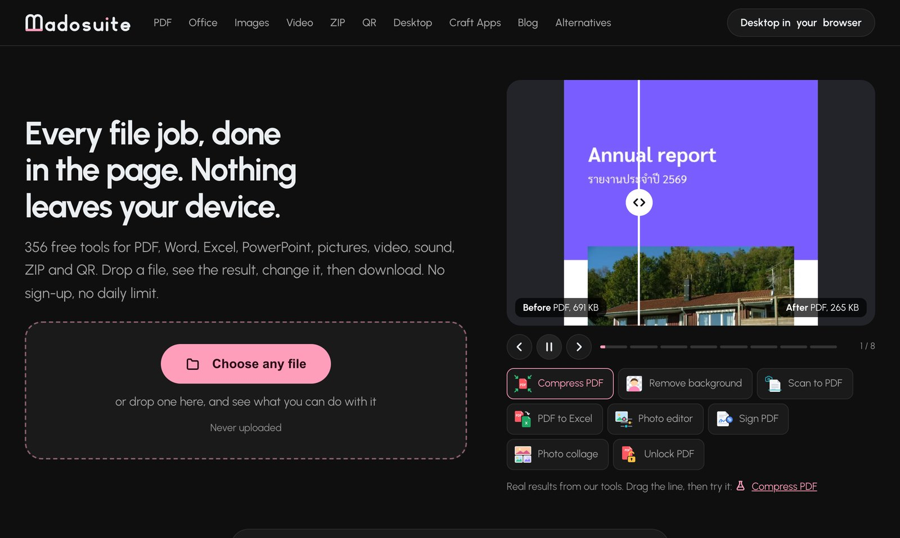
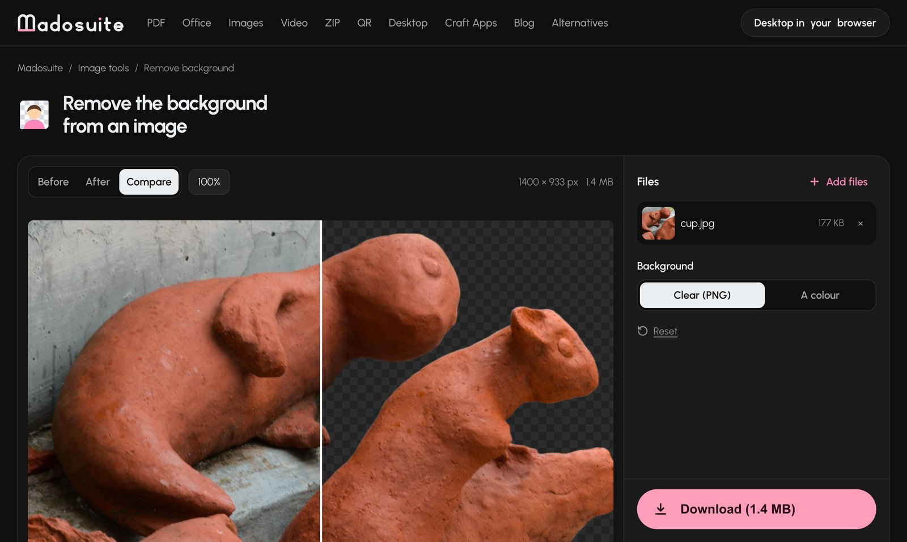
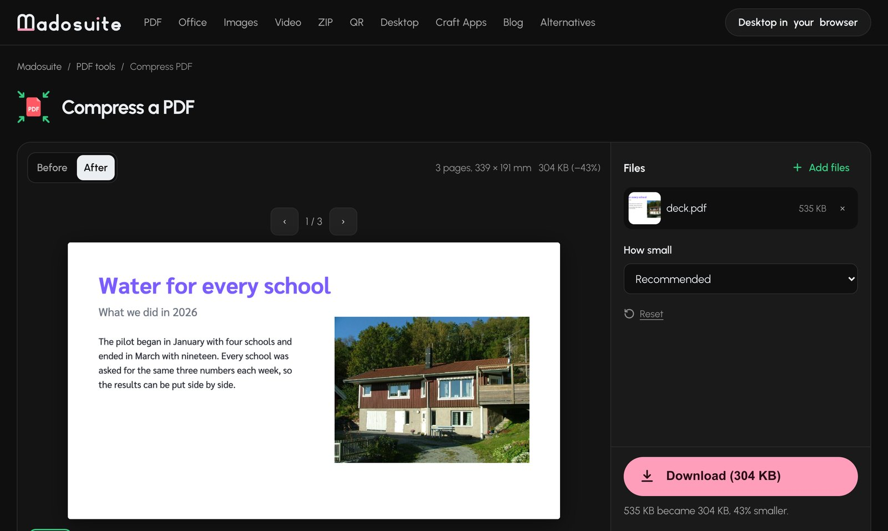
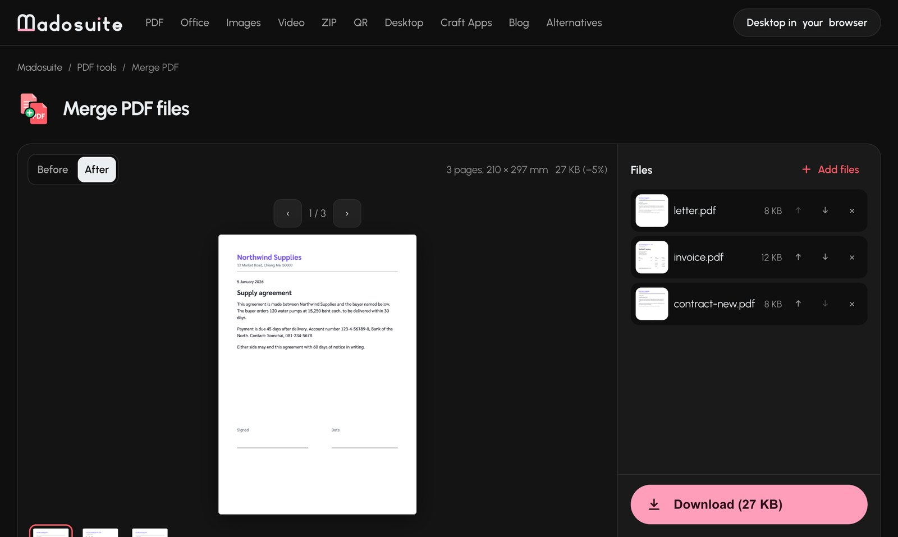
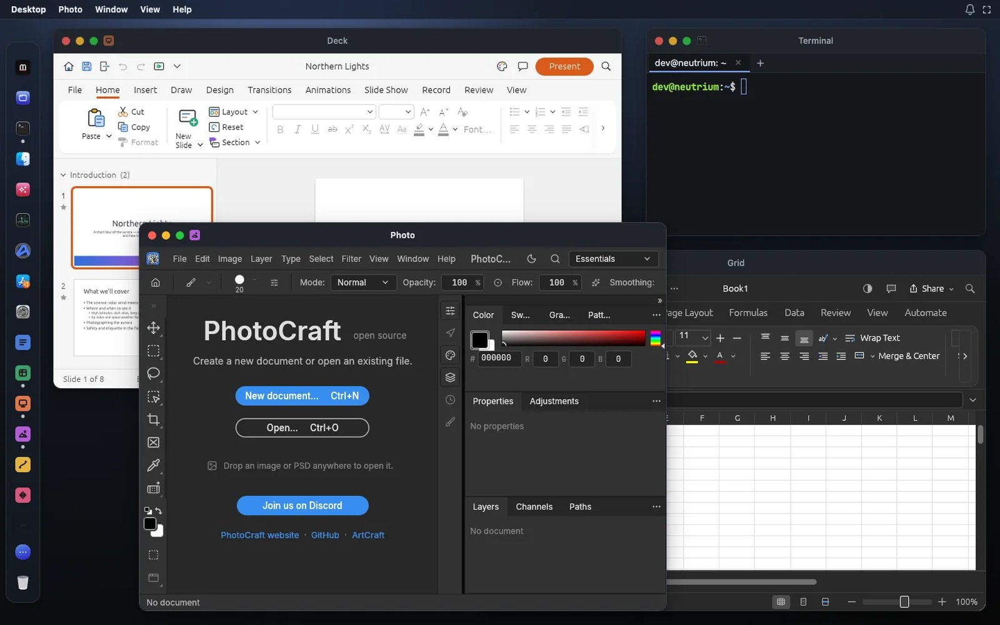
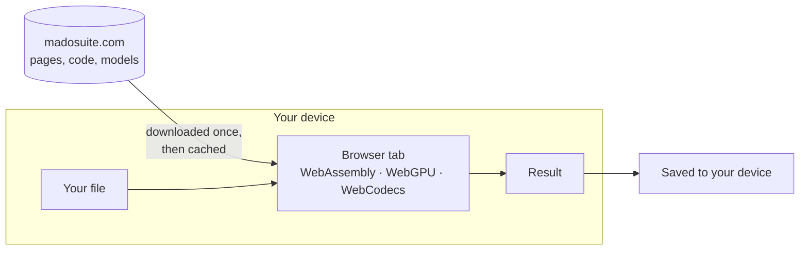

# Madosuite

by <a href="https://0cloud.dev"><b>0cloud</b></a> · powered by the 0cloud engine and <a href="https://uncontained.sh"><b>Uncontained</b></a>

**Every file job, done in the page. Nothing leaves your device.**

356 free tools for PDF, Word, Excel, PowerPoint, images, video, audio, ZIP and QR. 
They run in your browser, so your files are never uploaded. No sign-up, no daily limit, no watermark. 
A free alternative to <b>iLovePDF</b>, <b>Smallpdf</b>, <b>Adobe Acrobat online</b>, <b>remove.bg</b>, <b>TinyPNG</b>, <b>CloudConvert</b> and <b>WinRAR</b>, all in one place.

[**Open Madosuite →**](https://madosuite.com) &nbsp;·&nbsp; [All tools](https://madosuite.com/all-tools) &nbsp;·&nbsp; [Desktop in your browser](https://madosuite.com/desktop) &nbsp;·&nbsp; [Guides](https://madosuite.com/blog) &nbsp;·&nbsp; [Report a problem](../../issues/new/choose) &nbsp;·&nbsp; [ภาษาไทย](https://madosuite.com/th)

 

---

## Why it exists

Most free file sites work the same way: you upload a contract, a payslip or a passport scan, their server does the work, and you download the result. Your file sat on someone else's computer, even if only for an hour.

Madosuite does the same jobs **inside the browser tab**. The page downloads the code once; your file is read, changed and saved on your own device. You can check it yourself:

1. Open a tool, for example [Compress PDF](https://madosuite.com/compress-pdf).
2. Turn off Wi-Fi, or open DevTools → Network.
3. Drop a file in. It still works, and no request carries your file.

## Most used

| PDF | Office and images | Video, archives and more |
|---|---|---|
| [Merge PDF](https://madosuite.com/merge-pdf) | [Word to PDF](https://madosuite.com/word-to-pdf) | [Compress video](https://madosuite.com/compress-video) |
| [Compress PDF](https://madosuite.com/compress-pdf) | [Remove background](https://madosuite.com/remove-background) | [OCR PDF](https://madosuite.com/ocr-pdf) |
| [PDF to Word](https://madosuite.com/pdf-to-word) | [Compress image](https://madosuite.com/compress-image) | [Open RAR](https://madosuite.com/unrar-online) |
| [Sign PDF](https://madosuite.com/sign-pdf) | [HEIC to JPG](https://madosuite.com/heic-to-jpg) | [QR code generator](https://madosuite.com/qr-code-generator) |

## What a tool looks like

You see the result before you download it, and you can change the settings and watch it update.

<table>
<tr>
<td width="50%"> <b>Remove background</b> runs an AI model on your own GPU (WebGPU), or on the CPU where there is none.</td>
<td width="50%"> <b>Compress PDF</b> makes the pictures inside smaller and keeps text as text: here 535 KB became 304 KB.</td>
</tr>
<tr>
<td width="50%"> <b>Merge PDF</b> puts files in the order you choose and copies pages without re-rendering them.</td>
<td width="50%"> <b>Desktop in your browser</b>: open-source office and design apps side by side in one tab.</td>
</tr>
</table>

## A free alternative to iLovePDF, Smallpdf, remove.bg and the rest

The sites most people use for file jobs upload your file, then cap you: a few tasks an hour, a file-size limit, a watermark, or a paid plan for the rest. Madosuite does the same jobs on your own device, so there is nothing to cap.

| Instead of | Use | What changes |
|---|---|---|
| iLovePDF, Smallpdf, Sejda, PDF24 | [Merge](https://madosuite.com/merge-pdf), [compress](https://madosuite.com/compress-pdf), [convert](https://madosuite.com/pdf-to-word) and [sign](https://madosuite.com/sign-pdf) PDFs | No hourly task limit, no file-size cap, nothing uploaded |
| Adobe Acrobat online | [Edit PDF](https://madosuite.com/edit-pdf), [OCR PDF](https://madosuite.com/ocr-pdf), [Protect PDF](https://madosuite.com/protect-pdf) | No Adobe account |
| remove.bg | [Remove background](https://madosuite.com/remove-background) | Full-size result, free, the photo stays on your device |
| TinyPNG, Squoosh | [Compress image](https://madosuite.com/compress-image) | No 5 MB cap, a whole folder at once |
| CloudConvert, Convertio, Zamzar | [All converters](https://madosuite.com/all-tools) | No daily conversion count, no queue |
| Kapwing, Clideo, Clipchamp | [Compress video](https://madosuite.com/compress-video) and the [video tools](https://madosuite.com/video-tools) | No watermark, no account |
| WinRAR, WinZip, 7-Zip | [Open RAR](https://madosuite.com/unrar-online) and the [ZIP tools](https://madosuite.com/zip-tools) | Works on a Mac, a phone or a Chromebook, nothing to install |
| Photoshop, Microsoft 365, Figma | [The Desktop](https://madosuite.com/desktop) | Open-source apps in a tab, free |

Every comparison, with what each site limits and what Madosuite does instead, is on [madosuite.com/alternatives](https://madosuite.com/alternatives):

<b>PDF and scanning</b> · 14

 

- [iLovePDF Alternative That Never Uploads Your File](https://madosuite.com/alternatives/ilovepdf)
- [Free Smallpdf Alternative With No Daily Limit](https://madosuite.com/alternatives/smallpdf)
- [Adobe Acrobat Online Alternative, No Account](https://madosuite.com/alternatives/adobe-acrobat-online)
- [Free Acrobat Pro alternative in your browser: PDF](https://madosuite.com/alternatives/acrobat)
- [Sejda Alternative: No 3 Tasks an Hour, No 50 MB Cap](https://madosuite.com/alternatives/sejda)
- [PDF24 Alternative: No Install and No Server](https://madosuite.com/alternatives/pdf24)
- [PDF Candy Alternative Without Hourly Limits](https://madosuite.com/alternatives/pdf-candy)
- [Free Soda PDF Alternative in Your Browser](https://madosuite.com/alternatives/soda-pdf)
- [Free Xodo Alternative: More Than One Action a Day](https://madosuite.com/alternatives/xodo)
- [PDFgear Alternative You Do Not Have to Install](https://madosuite.com/alternatives/pdfgear)
- [Adobe Scan Alternative With Free Merge and OCR](https://madosuite.com/alternatives/adobe-scan)
- [CamScanner Alternative: Scan to PDF With No App](https://madosuite.com/alternatives/camscanner)
- [Microsoft Lens Alternative After Its Retirement](https://madosuite.com/alternatives/microsoft-lens)
- [OnlineOCR Alternative: OCR With No Hourly Limit](https://madosuite.com/alternatives/onlineocr)

<b>Images</b> · 9

 

- [iLoveIMG Alternative: Edit Images Without Uploading](https://madosuite.com/alternatives/iloveimg)
- [TinyPNG Alternative: No 5 MB Cap, No Upload](https://madosuite.com/alternatives/tinypng)
- [Squoosh Alternative for a Whole Folder of Pictures](https://madosuite.com/alternatives/squoosh)
- [Free remove.bg Alternative, Full Size, No Upload](https://madosuite.com/alternatives/remove-bg)
- [Free Bigjpg Alternative With No Monthly Count](https://madosuite.com/alternatives/bigjpg)
- [Free Fotor Alternative That Keeps Photos Private](https://madosuite.com/alternatives/fotor)
- [Free Pixlr Alternative: Photo Editing Without Ads](https://madosuite.com/alternatives/pixlr)
- [Photopea Alternative: Photo Editing Plus a Desktop](https://madosuite.com/alternatives/photopea)
- [SammaPix Alternative With AI That Stays Local](https://madosuite.com/alternatives/sammapix)

<b>File converters</b> · 6

 

- [CloudConvert Alternative: No 10-a-Day Limit](https://madosuite.com/alternatives/cloudconvert)
- [Convertio Alternative: Convert Files With No Upload](https://madosuite.com/alternatives/convertio)
- [Zamzar Alternative: More Than 2 Files a Day, Free](https://madosuite.com/alternatives/zamzar)
- [FreeConvert Alternative Without Conversion Minutes](https://madosuite.com/alternatives/freeconvert)
- [Online-Convert Alternative: No Queue, No Credits](https://madosuite.com/alternatives/online-convert)
- [123apps Alternative: Video and Audio Without Upload](https://madosuite.com/alternatives/123apps)

<b>Video and audio</b> · 5

 

- [Free Clideo Alternative With No Watermark](https://madosuite.com/alternatives/clideo)
- [Free Kapwing Alternative With No Watermark](https://madosuite.com/alternatives/kapwing)
- [Clipchamp Alternative Without a Microsoft Account](https://madosuite.com/alternatives/clipchamp)
- [HandBrake Alternative Online, Nothing to Install](https://madosuite.com/alternatives/handbrake)
- [Online Audio Converter Alternative, No Upload](https://madosuite.com/alternatives/online-audio-converter)

<b>ZIP and RAR</b> · 5

 

- [Free WinRAR Alternative: Open RAR Files Online](https://madosuite.com/alternatives/winrar)
- [Free WinZip Alternative: Unzip and Zip Online](https://madosuite.com/alternatives/winzip)
- [7-Zip Alternative for Mac, Phone and Chromebook](https://madosuite.com/alternatives/7-zip)
- [ezyZip Alternative With PDF and Picture Tools](https://madosuite.com/alternatives/ezyzip)
- [extract.me Alternative That Reads Files Locally](https://madosuite.com/alternatives/extract-me)

<b>QR codes</b> · 2

 

- [QR Code Generator Alternative: Free PNG and SVG](https://madosuite.com/alternatives/qr-code-generator)
- [Free QR TIGER Alternative: Codes That Never Expire](https://madosuite.com/alternatives/qr-tiger)

<b>Desktop apps, in the browser</b> · 19

 

- [Free Microsoft 365 alternative: 4 apps in your browser](https://madosuite.com/alternatives/microsoft-365)
- [Free Microsoft Word alternative in your browser: Word](https://madosuite.com/alternatives/microsoft-word)
- [Free Excel alternative in your browser: Grid](https://madosuite.com/alternatives/excel)
- [Free PowerPoint alternative in your browser: Deck](https://madosuite.com/alternatives/powerpoint)
- [Free Creative Cloud Pro alternative: 8 apps in your browser](https://madosuite.com/alternatives/creative-cloud)
- [Free Photoshop alternative in your browser: Photo](https://madosuite.com/alternatives/photoshop)
- [Free Lightroom alternative in your browser: Light](https://madosuite.com/alternatives/lightroom)
- [Free Illustrator alternative in your browser: Vector](https://madosuite.com/alternatives/illustrator)
- [Free InDesign alternative in your browser: Design](https://madosuite.com/alternatives/indesign)
- [Free Premiere Pro alternative in your browser: Film](https://madosuite.com/alternatives/premiere-pro)
- [Free After Effects alternative in your browser: Effect](https://madosuite.com/alternatives/after-effects)
- [Free Audition alternative in your browser: Sound](https://madosuite.com/alternatives/audition)
- [Free Figma alternative in your browser: Fig](https://madosuite.com/alternatives/figma)
- [Free Sketch Alternative for Windows and Linux](https://madosuite.com/alternatives/sketch)
- [Free CorelDRAW Alternative in Your Browser](https://madosuite.com/alternatives/coreldraw)
- [Free AutoCAD alternative in your browser: CAD](https://madosuite.com/alternatives/autocad)
- [Free AutoCAD LT alternative in your browser: CAD](https://madosuite.com/alternatives/autocad-lt)
- [Free Ableton Live alternative in your browser: Sound](https://madosuite.com/alternatives/ableton-live)
- [Free FL Studio alternative in your browser: Sound](https://madosuite.com/alternatives/fl-studio)

## All 356 tools

<b>Organize PDF</b> · 12 tools

 

[Merge PDF](https://madosuite.com/merge-pdf) · [Split PDF](https://madosuite.com/split-pdf) · [Remove pages](https://madosuite.com/remove-pages-from-pdf) · [Extract pages](https://madosuite.com/extract-pdf-pages) · [Organize PDF](https://madosuite.com/organize-pdf) · [Rotate PDF](https://madosuite.com/rotate-pdf) · [Pages per sheet](https://madosuite.com/pdf-pages-per-sheet) · [Resize PDF pages](https://madosuite.com/resize-pdf-pages) · [Remove blank pages](https://madosuite.com/remove-blank-pages) · [Split PDF pages in half](https://madosuite.com/split-pdf-down-the-middle) · [Interleave PDF pages](https://madosuite.com/interleave-pdf) · [Auto crop PDF](https://madosuite.com/auto-crop-pdf)

<b>Optimize PDF</b> · 6 tools

 

[Compress PDF](https://madosuite.com/compress-pdf) · [Repair PDF](https://madosuite.com/repair-pdf) · [Flatten PDF](https://madosuite.com/flatten-pdf) · [OCR PDF](https://madosuite.com/ocr-pdf) · [Summarize PDF](https://madosuite.com/summarize-pdf) · [Grayscale PDF](https://madosuite.com/grayscale-pdf)

<b>Convert to PDF</b> · 13 tools

 

[JPG to PDF](https://madosuite.com/jpg-to-pdf) · [Word to PDF](https://madosuite.com/word-to-pdf) · [PowerPoint to PDF](https://madosuite.com/powerpoint-to-pdf) · [Excel to PDF](https://madosuite.com/excel-to-pdf) · [HTML to PDF](https://madosuite.com/html-to-pdf) · [Markdown to PDF](https://madosuite.com/markdown-to-pdf) · [Scan to PDF](https://madosuite.com/scan-to-pdf) · [Text to PDF](https://madosuite.com/text-to-pdf) · [EPUB to PDF](https://madosuite.com/epub-to-pdf) · [EML to PDF](https://madosuite.com/eml-to-pdf) · [MSG to PDF](https://madosuite.com/msg-to-pdf) · [RTF to PDF](https://madosuite.com/rtf-to-pdf) · [ODT to PDF](https://madosuite.com/odt-to-pdf)

<b>Convert from PDF</b> · 14 tools

 

[PDF to Word](https://madosuite.com/pdf-to-word) · [PDF to Excel](https://madosuite.com/pdf-to-excel) · [PDF to PowerPoint](https://madosuite.com/pdf-to-powerpoint) · [PDF to JPG](https://madosuite.com/pdf-to-jpg) · [PDF to Markdown](https://madosuite.com/pdf-to-markdown) · [PDF to Text](https://madosuite.com/pdf-to-text) · [PDF to HTML](https://madosuite.com/pdf-to-html) · [Extract images](https://madosuite.com/extract-images-from-pdf) · [PDF to PDF/A](https://madosuite.com/pdf-to-pdfa) · [PDF to PNG](https://madosuite.com/pdf-to-png) · [PDF to TIFF](https://madosuite.com/pdf-to-tiff) · [PDF to CSV](https://madosuite.com/pdf-to-csv) · [PDF to EPUB](https://madosuite.com/pdf-to-epub) · [PDF to one long image](https://madosuite.com/pdf-to-one-image)

<b>Edit PDF</b> · 15 tools

 

[Edit PDF](https://madosuite.com/edit-pdf) · [Sign PDF](https://madosuite.com/sign-pdf) · [Watermark PDF](https://madosuite.com/watermark-pdf) · [Page numbers](https://madosuite.com/add-page-numbers-to-pdf) · [Crop PDF](https://madosuite.com/crop-pdf) · [Compare PDF](https://madosuite.com/compare-pdf) · [Fill PDF form](https://madosuite.com/fill-pdf-form) · [Translate PDF](https://madosuite.com/translate-pdf) · [Add image or QR to PDF](https://madosuite.com/add-image-to-pdf) · [Header and footer](https://madosuite.com/header-footer-pdf) · [Bates numbering](https://madosuite.com/bates-numbering) · [Edit PDF metadata](https://madosuite.com/edit-pdf-metadata) · [PDF bookmarks](https://madosuite.com/pdf-bookmarks) · [PDF dark mode](https://madosuite.com/pdf-dark-mode) · [Attach files to PDF](https://madosuite.com/attach-files-to-pdf)

<b>PDF security</b> · 5 tools

 

[Unlock PDF](https://madosuite.com/unlock-pdf) · [Protect PDF](https://madosuite.com/protect-pdf) · [Sign with certificate](https://madosuite.com/sign-with-certificate) · [Verify signature](https://madosuite.com/verify-signature) · [Redact PDF](https://madosuite.com/redact-pdf)

<b>Word, Excel, PowerPoint</b> · 46 tools

 

[Merge Excel](https://madosuite.com/merge-excel) · [Split Excel](https://madosuite.com/split-excel) · [Remove duplicate rows](https://madosuite.com/remove-duplicate-rows) · [Excel to CSV](https://madosuite.com/excel-to-csv) · [CSV to Excel](https://madosuite.com/csv-to-excel) · [Remove Excel protection](https://madosuite.com/unlock-excel) · [Compress PowerPoint](https://madosuite.com/compress-powerpoint) · [Compress Word](https://madosuite.com/compress-word) · [Compress Excel](https://madosuite.com/compress-excel) · [Extract images from Office](https://madosuite.com/extract-images-from-office) · [Word counter](https://madosuite.com/word-counter) · [Baht in words](https://madosuite.com/baht-text) · [VAT calculator](https://madosuite.com/vat-calculator) · [Receipt and invoice reader](https://madosuite.com/extract-document) · [Sort documents](https://madosuite.com/organize-documents) · [Image to Word](https://madosuite.com/image-to-word) · [ID card copy](https://madosuite.com/id-card-copy-watermark) · [Certificate maker](https://madosuite.com/certificate-maker) · [Name tag maker](https://madosuite.com/name-tag-maker) · [Mail merge to PDF](https://madosuite.com/mail-merge-pdf) · [Compare Excel files](https://madosuite.com/compare-excel) · [VLOOKUP two files](https://madosuite.com/lookup-excel) · [Split a column](https://madosuite.com/split-column) · [Merge columns](https://madosuite.com/merge-columns) · [Filter Excel rows](https://madosuite.com/filter-excel) · [Sort Excel](https://madosuite.com/sort-excel) · [Pivot summary](https://madosuite.com/pivot-summary) · [Transpose Excel](https://madosuite.com/transpose-excel) · [Fill blank cells](https://madosuite.com/fill-blanks) · [Clean Excel data](https://madosuite.com/clean-excel) · [Excel to JSON](https://madosuite.com/excel-to-json) · [JSON to Excel](https://madosuite.com/json-to-excel) · [CSV to JSON](https://madosuite.com/csv-to-json) · [JSON to CSV](https://madosuite.com/json-to-csv) · [XML to JSON](https://madosuite.com/xml-to-json) · [XML to Excel](https://madosuite.com/xml-to-excel) · [Excel to HTML table](https://madosuite.com/excel-to-html) · [Excel to image](https://madosuite.com/excel-to-image) · [Excel to vCard](https://madosuite.com/excel-to-vcard) · [vCard to Excel](https://madosuite.com/vcard-to-excel) · [CSV splitter](https://madosuite.com/csv-splitter) · [CSV viewer](https://madosuite.com/csv-viewer) · [Random sample rows](https://madosuite.com/random-sample-rows) · [Numbers to words in Excel](https://madosuite.com/number-to-text-excel) · [BAHTTEXT for a column](https://madosuite.com/excel-baht-text) · [Protect Excel sheet](https://madosuite.com/protect-excel-sheet)

<b>Change picture type</b> · 26 tools

 

[HEIC to JPG](https://madosuite.com/heic-to-jpg) · [Convert to JPG](https://madosuite.com/convert-to-jpg) · [JPG to PNG](https://madosuite.com/jpg-to-png) · [Convert to WebP](https://madosuite.com/convert-to-webp) · [HTML to image](https://madosuite.com/html-to-image) · [PNG to JPG](https://madosuite.com/png-to-jpg) · [WebP to JPG](https://madosuite.com/webp-to-jpg) · [WebP to PNG](https://madosuite.com/webp-to-png) · [AVIF to JPG](https://madosuite.com/avif-to-jpg) · [SVG to PNG](https://madosuite.com/svg-to-png) · [Convert to AVIF](https://madosuite.com/convert-to-avif) · [Convert to JPEG XL](https://madosuite.com/convert-to-jxl) · [JXL to JPG](https://madosuite.com/jxl-to-jpg) · [RAW to JPG](https://madosuite.com/raw-to-jpg) · [Favicon generator](https://madosuite.com/favicon-generator) · [Image to Base64](https://madosuite.com/image-to-base64) · [Image to SVG](https://madosuite.com/image-to-svg) · [PSD to PNG](https://madosuite.com/psd-to-png) · [PSD to JPG](https://madosuite.com/psd-to-jpg) · [TIFF to JPG](https://madosuite.com/tiff-to-jpg) · [HEIC to PNG](https://madosuite.com/heic-to-png) · [BMP to JPG](https://madosuite.com/bmp-to-jpg) · [BMP to PNG](https://madosuite.com/bmp-to-png) · [Convert to BMP](https://madosuite.com/convert-to-bmp) · [ICO to PNG](https://madosuite.com/ico-to-png) · [PNG to ICO](https://madosuite.com/png-to-ico)

<b>Edit pictures</b> · 48 tools

 

[Compress image](https://madosuite.com/compress-image) · [Resize image](https://madosuite.com/resize-image) · [Image to text](https://madosuite.com/image-to-text) · [Crop image](https://madosuite.com/crop-image) · [Rotate image](https://madosuite.com/rotate-image) · [Watermark image](https://madosuite.com/watermark-image) · [Meme generator](https://madosuite.com/meme-generator) · [Photo editor](https://madosuite.com/photo-editor) · [Blur part of image](https://madosuite.com/blur-image) · [Remove background](https://madosuite.com/remove-background) · [Upscale image](https://madosuite.com/upscale-image) · [Add border](https://madosuite.com/add-border) · [Round image](https://madosuite.com/round-image) · [Photo collage](https://madosuite.com/collage) · [Instagram grid splitter](https://madosuite.com/instagram-grid) · [Passport photo](https://madosuite.com/passport-photo) · [Add text to image](https://madosuite.com/add-text-to-image) · [Flip image](https://madosuite.com/flip-image) · [Enhance photo](https://madosuite.com/enhance-photo) · [Film filters](https://madosuite.com/film-filter) · [Colour picker](https://madosuite.com/color-picker) · [Match colours](https://madosuite.com/color-match) · [Social media resizer](https://madosuite.com/social-media-resizer) · [AI label](https://madosuite.com/ai-label) · [Optimize for web](https://madosuite.com/optimize-images-for-web) · [Signature to PNG](https://madosuite.com/signature-to-png) · [Alt text](https://madosuite.com/alt-text) · [Remove object from photo](https://madosuite.com/remove-object) · [Sharpen image](https://madosuite.com/sharpen-image) · [Unblur image](https://madosuite.com/unblur-image) · [Images to GIF](https://madosuite.com/images-to-gif) · [Compress GIF](https://madosuite.com/compress-gif) · [Resize GIF](https://madosuite.com/resize-gif) · [Crop GIF](https://madosuite.com/crop-gif) · [GIF to frames](https://madosuite.com/gif-to-frames) · [Reverse GIF](https://madosuite.com/reverse-gif) · [Split image](https://madosuite.com/split-image) · [Pixelate image](https://madosuite.com/pixelate-image) · [Grayscale image](https://madosuite.com/grayscale-image) · [Change image DPI](https://madosuite.com/change-image-dpi) · [Add logo to photos](https://madosuite.com/add-logo-to-image) · [Screenshot mockup](https://madosuite.com/screenshot-mockup) · [Before and after](https://madosuite.com/before-after-image) · [Replace background](https://madosuite.com/replace-background) · [White background product photos](https://madosuite.com/product-photo-white) · [Photo print sheet](https://madosuite.com/photo-print-sheet) · [Sprite sheet](https://madosuite.com/sprite-sheet) · [Take a photo](https://madosuite.com/take-photo)

<b>Sort and check photos</b> · 9 tools

 

[Batch rename](https://madosuite.com/batch-rename) · [Photo culling](https://madosuite.com/photo-culling) · [Sort photos](https://madosuite.com/sort-photos-by-place) · [Find duplicate photos](https://madosuite.com/duplicate-photo-finder) · [Photo map](https://madosuite.com/photo-map) · [View EXIF](https://madosuite.com/view-exif) · [Remove EXIF](https://madosuite.com/remove-exif) · [Sort photos by subject](https://madosuite.com/sort-photos-by-subject) · [Name photos by content](https://madosuite.com/ai-rename)

<b>Video</b> · 33 tools

 

[Compress video](https://madosuite.com/compress-video) · [Convert video](https://madosuite.com/convert-video) · [MOV to MP4](https://madosuite.com/mov-to-mp4) · [WebM to MP4](https://madosuite.com/webm-to-mp4) · [MKV to MP4](https://madosuite.com/mkv-to-mp4) · [Resize video](https://madosuite.com/resize-video) · [Trim video](https://madosuite.com/trim-video) · [Mute video](https://madosuite.com/mute-video) · [Video to GIF](https://madosuite.com/video-to-gif) · [GIF to MP4](https://madosuite.com/gif-to-mp4) · [Merge videos](https://madosuite.com/merge-videos) · [Crop video](https://madosuite.com/crop-video) · [Rotate video](https://madosuite.com/rotate-video) · [Flip video](https://madosuite.com/flip-video) · [Video speed](https://madosuite.com/video-speed) · [Reverse video](https://madosuite.com/reverse-video) · [Add music to video](https://madosuite.com/add-audio-to-video) · [Video volume](https://madosuite.com/change-video-volume) · [Add text to video](https://madosuite.com/add-text-to-video) · [Add subtitles to video](https://madosuite.com/add-subtitles-to-video) · [Watermark video](https://madosuite.com/watermark-video) · [Video to images](https://madosuite.com/video-to-images) · [Images to video](https://madosuite.com/images-to-video) · [Video thumbnail](https://madosuite.com/video-thumbnail) · [Loop video](https://madosuite.com/loop-video) · [Resize video for social](https://madosuite.com/resize-video-for-social) · [Split video](https://madosuite.com/split-video) · [Convert to WebM](https://madosuite.com/convert-to-webm) · [Video to animated WebP](https://madosuite.com/video-to-webp) · [Video to APNG](https://madosuite.com/video-to-apng) · [Subtitle converter](https://madosuite.com/subtitle-converter) · [Screen recorder](https://madosuite.com/screen-recorder) · [Webcam recorder](https://madosuite.com/webcam-recorder)

<b>Sound</b> · 23 tools

 

[Video to MP3](https://madosuite.com/video-to-mp3) · [Extract audio](https://madosuite.com/extract-audio) · [Convert audio](https://madosuite.com/convert-audio) · [M4A to MP3](https://madosuite.com/m4a-to-mp3) · [WAV to MP3](https://madosuite.com/wav-to-mp3) · [Trim audio](https://madosuite.com/trim-audio) · [Merge audio](https://madosuite.com/merge-audio) · [Audio to text](https://madosuite.com/transcribe) · [Change audio speed](https://madosuite.com/change-audio-speed) · [Change pitch](https://madosuite.com/change-pitch) · [Audio volume](https://madosuite.com/change-audio-volume) · [Normalize audio](https://madosuite.com/normalize-audio) · [Remove noise](https://madosuite.com/remove-noise) · [Remove silence](https://madosuite.com/remove-silence) · [Reverse audio](https://madosuite.com/reverse-audio) · [Stereo to mono](https://madosuite.com/stereo-to-mono) · [Split audio](https://madosuite.com/split-audio) · [Ringtone maker](https://madosuite.com/ringtone-maker) · [Audio to FLAC](https://madosuite.com/audio-to-flac) · [Audio to OGG](https://madosuite.com/audio-to-ogg) · [Sound equalizer](https://madosuite.com/sound-equalizer) · [Vocal remover](https://madosuite.com/vocal-remover) · [Voice recorder](https://madosuite.com/voice-recorder)

<b>ZIP and archives</b> · 12 tools

 

[Extract archive](https://madosuite.com/extract-archive) · [Open RAR](https://madosuite.com/unrar-online) · [Open 7Z](https://madosuite.com/open-7z) · [Unzip](https://madosuite.com/unzip-online) · [Open TAR.GZ](https://madosuite.com/extract-tar-gz) · [Open ISO](https://madosuite.com/extract-iso) · [Open APK or IPA](https://madosuite.com/open-apk) · [Open MCPACK](https://madosuite.com/open-mcpack) · [RAR to ZIP](https://madosuite.com/rar-to-zip) · [7Z to ZIP](https://madosuite.com/7z-to-zip) · [TAR to ZIP](https://madosuite.com/tar-to-zip) · [Create ZIP](https://madosuite.com/create-zip)

<b>Codes and small tools</b> · 36 tools

 

[QR code generator](https://madosuite.com/qr-code-generator) · [QR code reader](https://madosuite.com/qr-code-reader) · [Barcode generator](https://madosuite.com/barcode-generator) · [Barcode reader](https://madosuite.com/barcode-reader) · [Hash generator](https://madosuite.com/hash-generator) · [JSON formatter](https://madosuite.com/json-formatter) · [Password generator](https://madosuite.com/password-generator) · [URL encoder](https://madosuite.com/url-encoder) · [Aspect ratio](https://madosuite.com/aspect-ratio-calculator) · [3D viewer and converter](https://madosuite.com/3d-converter) · [YAML ↔ JSON](https://madosuite.com/yaml-json-converter) · [Excel to SQL](https://madosuite.com/excel-to-sql) · [Base64 encode and decode](https://madosuite.com/base64-text) · [JWT decoder](https://madosuite.com/jwt-decoder) · [UUID generator](https://madosuite.com/uuid-generator) · [Unix timestamp converter](https://madosuite.com/timestamp-converter) · [Regex tester](https://madosuite.com/regex-tester) · [Colour converter](https://madosuite.com/color-converter) · [Contrast checker](https://madosuite.com/contrast-checker) · [CSS gradient maker](https://madosuite.com/gradient-maker) · [Code formatter](https://madosuite.com/code-formatter) · [Code minifier](https://madosuite.com/code-minifier) · [HTML entities](https://madosuite.com/html-entities) · [Query string parser](https://madosuite.com/query-string-parser) · [Cron expression explainer](https://madosuite.com/cron-explainer) · [Markdown table maker](https://madosuite.com/markdown-table-maker) · [Meta tag generator](https://madosuite.com/meta-tag-generator) · [robots.txt generator](https://madosuite.com/robots-txt-generator) · [Sitemap generator](https://madosuite.com/sitemap-generator) · [Text encoding converter](https://madosuite.com/text-encoding-converter) · [Number base converter](https://madosuite.com/number-base-converter) · [Roman numerals](https://madosuite.com/roman-numerals) · [PX to REM converter](https://madosuite.com/px-to-rem) · [Password strength checker](https://madosuite.com/password-strength) · [JSON diff](https://madosuite.com/json-diff) · [JSON to TypeScript](https://madosuite.com/json-to-typescript)

<b>Text and Thai</b> · 24 tools

 

[Wrong keyboard fixer](https://madosuite.com/thai-keyboard-fixer) · [Thai numerals](https://madosuite.com/thai-numerals) · [Buddhist year converter](https://madosuite.com/buddhist-year-converter) · [Thai date writer](https://madosuite.com/thai-date-writer) · [Fix Thai text](https://madosuite.com/fix-thai-text) · [Thai word segmenter](https://madosuite.com/thai-word-segmenter) · [Thai ID number check](https://madosuite.com/thai-id-check) · [Number to words](https://madosuite.com/number-to-words) · [Case converter](https://madosuite.com/case-converter) · [Remove duplicate lines](https://madosuite.com/remove-duplicate-lines) · [Sort lines](https://madosuite.com/sort-lines) · [Text compare](https://madosuite.com/text-compare) · [Find and replace](https://madosuite.com/find-and-replace) · [Remove line breaks](https://madosuite.com/remove-line-breaks) · [Add line numbers](https://madosuite.com/add-line-numbers) · [Text to columns](https://madosuite.com/text-to-columns) · [Word frequency](https://madosuite.com/word-frequency) · [Clean text](https://madosuite.com/clean-text) · [Lorem ipsum](https://madosuite.com/lorem-ipsum) · [Reverse text](https://madosuite.com/reverse-text) · [Slug generator](https://madosuite.com/slug-generator) · [Hidden character finder](https://madosuite.com/hidden-character-finder) · [Markdown editor](https://madosuite.com/markdown-editor) · [HTML to Markdown](https://madosuite.com/html-to-markdown)

<b>Business and money</b> · 20 tools

 

[Invoice generator](https://madosuite.com/invoice-generator) · [Quotation generator](https://madosuite.com/quotation-generator) · [Receipt generator](https://madosuite.com/receipt-generator) · [Purchase order](https://madosuite.com/purchase-order) · [Delivery note](https://madosuite.com/delivery-note) · [Payslip generator](https://madosuite.com/payslip-generator) · [Price tag and label maker](https://madosuite.com/price-tag-maker) · [Business card maker](https://madosuite.com/business-card-maker) · [Resume builder](https://madosuite.com/resume-builder) · [Loan calculator](https://madosuite.com/loan-calculator) · [Discount calculator](https://madosuite.com/discount-calculator) · [Percentage calculator](https://madosuite.com/percentage-calculator) · [Profit margin calculator](https://madosuite.com/profit-margin-calculator) · [Unit converter](https://madosuite.com/unit-converter) · [Date calculator](https://madosuite.com/date-calculator) · [Age calculator](https://madosuite.com/age-calculator) · [Hours worked calculator](https://madosuite.com/hours-calculator) · [Split the bill](https://madosuite.com/split-bill) · [Overtime calculator](https://madosuite.com/overtime-calculator) · [BMI calculator](https://madosuite.com/bmi-calculator)

<b>School, teaching and picking at random</b> · 14 tools

 

[GPA calculator](https://madosuite.com/gpa-calculator) · [Random name picker](https://madosuite.com/random-picker) · [Random group maker](https://madosuite.com/group-maker) · [Random number generator](https://madosuite.com/random-number) · [Bingo card maker](https://madosuite.com/bingo-card-maker) · [Seating plan maker](https://madosuite.com/seat-plan-maker) · [Timetable maker](https://madosuite.com/timetable-maker) · [Calendar maker](https://madosuite.com/calendar-maker) · [Math worksheet maker](https://madosuite.com/math-worksheet) · [Flashcard maker](https://madosuite.com/flashcard-maker) · [Printable paper](https://madosuite.com/printable-paper) · [Bulk QR codes](https://madosuite.com/qr-code-bulk) · [Bulk barcodes](https://madosuite.com/barcode-bulk) · [Contact QR code](https://madosuite.com/vcard-qr)

## Desktop in your browser

[The Desktop](https://madosuite.com/desktop) opens 13 apps side by side in one tab, sharing the same files: a word processor, spreadsheet, presentations, PDF editor, image editor, vector illustration, photo library and raw editor, interface design, page layout, video, sound, motion effects and CAD. They open and save real `.docx`, `.xlsx`, `.pptx`, `.psd` and more.

The Desktop itself (its windows, Files, a Terminal and a real Linux machine in the tab) is built by [0cloud](https://0cloud.dev) on the 0cloud engine, powered by [Uncontained](https://uncontained.sh): Node.js, Bun, WebAssembly and arm64 Linux programs running in the browser tab on a real Linux kernel, with no server running them.

The apps are the **ArtCraft team's open-source Crafting Apps** ([getartcraft.com](https://getartcraft.com)), used under MIT or Apache-2.0. Madosuite is not ArtCraft and is not affiliated with it. They are early alpha: each [app page](https://madosuite.com/apps) says what works and what doesn't yet.

## How it works

The server only hands out the same static files to everyone. There is no endpoint a file could be sent to.

| Job | What does the work |
|---|---|
| PDF structure: merge, split, passwords, repair | [QPDF](https://github.com/qpdf/qpdf) compiled to WebAssembly |
| Showing and reading PDF pages | [PDF.js](https://github.com/mozilla/pdf.js) |
| OCR | [Tesseract](https://github.com/tesseract-ocr/tesseract) via [tesseract.js](https://github.com/naptha/tesseract.js) |
| Remove background, upscale, find faces | [ONNX Runtime Web](https://onnxruntime.ai/) on WebGPU or WebAssembly |
| Video and audio | [Mediabunny](https://mediabunny.dev/) on WebCodecs, with wasm encoders where the browser has none |
| RAR, 7z, ISO and other archives | [libarchive.js](https://github.com/nika-begiashvili/libarchivejs) |
| Audio to text | Whisper models on ONNX Runtime Web |
| Translate PDF | Mozilla's Firefox Translations models |
| Desktop, Files, Terminal, Linux in the tab | The 0cloud engine, powered by [Uncontained](https://uncontained.sh) |
| Summarize PDF (optional rewrite) | Gemma 4 E2B via [wllama](https://github.com/ngxson/wllama), a one-time 3.2 GB download, computers only |

Every project and model is listed with its licence on the [credits page](https://madosuite.com/credits).

## Browsers

| | Chrome / Edge | Safari | Firefox |
|---|:---:|:---:|:---:|
| PDF, Office, images, archives, QR | ✅ | ✅ | ✅ |
| Video and audio | ✅ | ✅ | ✅ |
| AI on the GPU (WebGPU) | ✅ | ✅ | where WebGPU is on |
| Works offline after first use | ✅ | ✅ | ✅ |

On phones everything above works except the PDF summary rewrite, which needs a computer's memory. Very large files are limited by your device's RAM.

## Questions

<b>Is it really free?</b>

 
Yes. No account, no daily limit, no watermark, no paid plan. Because the work happens on your device, hosting is just static files.

<b>How can I be sure nothing is uploaded?</b>

 
Open DevTools → Network and run a tool: you'll see the page fetch code and models, and no request carrying your file. Or load the page, turn off your internet, and use it.

<b>Does it work offline?</b>

 
Yes, for any tool you have opened once. Its page and code stay on your device.

<b>Is the source code here?</b>

 
Not at the moment. This repository is where you can report problems, ask for tools and follow what changes. The open-source projects Madosuite is built on are on the <a href="https://madosuite.com/credits">credits page</a>.

<b>Can I use it at work with confidential files?</b>

 
That is what it is for: the file never leaves the computer you are using. Check your company's rules on browser tools all the same.

## Report a problem or ask for a tool

- 🐞 [**Something didn't work**](../../issues/new?template=bug.yml): tell us the tool, your browser and what happened.
- 💡 [**Ask for a tool**](../../issues/new?template=tool.yml): a file job you still do somewhere else.

You don't need to attach a private file. If a file fails, a description or a harmless sample that fails the same way is enough.

---

<b>Madosuite by <a href="https://0cloud.dev">0cloud</a></b> · powered by the 0cloud engine and <a href="https://uncontained.sh">Uncontained</a> 
<a href="https://madosuite.com">madosuite.com</a> · <a href="https://0cloud.dev">0cloud.dev</a> · <a href="https://uncontained.sh">uncontained.sh</a> · <a href="https://madosuite.com/th">ภาษาไทย</a> · <a href="https://madosuite.com/credits">Credits and licences</a>

